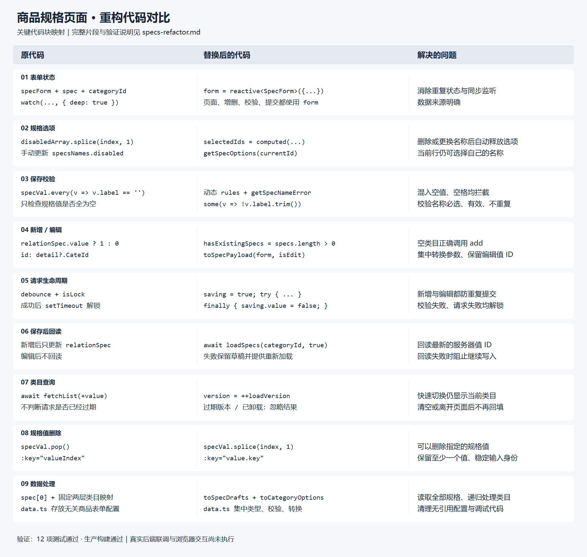
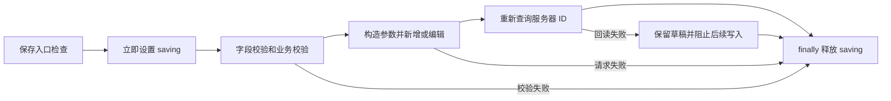

# 商品规格页面重构对比



[SVG 原图](./specs-refactor-comparison.svg)

图中展示关键片段；以下列出对应的完整逻辑入口。

| 原代码块 | 替换后的代码块 | 解决的问题 |
| --- | --- | --- |
| `specForm`、`spec`、`categoryId` 与同步 `watch` | `form: SpecForm` | 消除重复状态，页面和提交使用同一份数据 |
| `disabledArray`、`onUpdateSelectedSpec`、手动修改 `specsNames.disabled` | `selectedIds`、`getSpecOptions` | 删除或更换规格后自动释放正确选项，当前行保留自身选项 |
| `curSpecCount`、`specMax` 和数量监听 | `canAddSpec` | 数量从表单与字典计算，查询完成前无法添加 |
| `btnDisabled` 的深度监听 | 动态 `rules`、`getSpecNameError`、`getSpecFormError` | 未选规格、重复名称、混入空值或只有空格均不能提交，并显示字段错误 |
| `relationSpec.value ? 1 : 0` | `hasExistingSpecs = specs.length > 0` | 空类目走新增，已有规格走编辑 |
| `cloneDeep`、两套 `map`、`detail?.CateId` | `toSpecPayload(form, isEdit)` | 集中构造参数，保留编辑所需规格值 ID，不提交 UI key |
| `handleSave`、`handleEdit`、`debounce`、`isLock`、延时解锁 | `onSave`、`saving`、`try/finally` | 新增与编辑都防重复提交，校验失败或请求失败均释放锁 |
| 查询后只更新 `relationSpec` | 保存后 `loadSpecs(categoryId, true)` | 回读服务器生成的 ID；回读失败时保留草稿，阻止继续写入，提供重试 |
| `handleUpdateValue` 无请求版本判断 | `loadSpecs`、`loadVersion`、`disposed` | 防止旧类目请求覆盖当前类目，清空类目或离开页面后忽略在途结果 |
| `removeSpecValue` 中 `pop()`，列表使用索引 key | `splice(index, 1)`、稳定 `key` | 删除指定值，保留至少一个值，其他输入框身份稳定 |
| 两层类目映射、每条记录只读取 `spec[0]` | `toCategoryOptions`、`toSpecDrafts` | 支持更深类目树，读取记录里的全部规格 |
| 未被引用的旧 `data.ts` 表格、商品表单配置 | 当前页面的类型、工厂、校验与转换函数 | 去掉无关配置，让页面交互与数据处理各自集中 |

## 1. 三份状态改为一份表单

原代码：

```ts
const specForm: any = reactive({ categoryId: '', spec: [] });
const spec = ref([]);
const categoryId = ref();
watch(() => specForm.spec, _spec => { spec.value = _spec; }, { deep: true });
watch(() => specForm.categoryId, _categoryId => {
  categoryId.value = _categoryId;
}, { deep: true });
```

新代码（`index.vue`）：

```ts
const form = reactive<SpecForm>({ categoryId: null, specs: [] });
```

模板、增删操作、校验和提交直接使用 `form`。`curSpecCount`、`specMax` 不再单独维护，`canAddSpec` 根据 `form.specs.length` 和规格字典数量计算。

## 2. 手工禁用选项改为派生状态

原代码：

```ts
if (disabledArray[index]) disabledArray.splice(index, 1);
if (!disabledArray.includes(id)) disabledArray.push(id);
specsNames.value.forEach((item: any) => {
  item.disabled = disabledArray.includes(item.value);
});
```

新代码（`index.vue`）：

```ts
const selectedIds = computed(() => new Set(form.specs.map(spec => spec.dictionaryId)));
const getSpecOptions = (currentId: number | null) => specNames.value.map(option => ({
  ...option,
  disabled: option.value !== currentId && selectedIds.value.has(option.value),
}));
```

例如第一行从“颜色”改为“尺码”，其他行立即可以选择“颜色”；删除该行后“尺码”也自动释放。无需维护另一个按索引排列的数组。

## 3. “全为空才拦截”改为逐项校验

原代码关键条件：

```ts
specVal.length === 0 || specVal.every(specV => specV.label == '')
```

新代码（`data.ts` 中 `getSpecFormError`）：

```ts
if (!spec.specVal.length || spec.specVal.some(value => !value.label.trim())) {
  return `第 ${index + 1} 个规格：请填写每个规格值`;
}
```

原来的 `['红色', '']`、`['   ']` 可以通过；现在会拦截。`getSpecNameError` 同时检查名称必选、存在于字典中、同类目不重复。`index.vue` 的动态 `rules` 使用每个输入框的实际路径，让错误落在对应字段旁。

## 4. 新增/编辑判断与参数转换

原代码：

```ts
edits.value = relationSpec.value ? 1 : 0;
// 编辑分支中：
id: detail?.CateId,
```

新代码（`index.vue`）：

```ts
hasExistingSpecs.value = specs.length > 0;
const isEdit = hasExistingSpecs.value;
await (isEdit ? edit : add)(toSpecPayload(form, isEdit));
```

新代码（`data.ts` 的 `toSpecPayload` 内）：

```ts
specVal: spec.specVal.map(value => ({
  val: value.label.trim(),
  ...(isEdit ? { id: value.id } : {}),
})),
```

空数组不再被当作已有规格。提交继续采用 `{ categoryId, spec: [{ dictionaryId, specVal }] }`；新增值仅含 `val`，编辑值包含 `val` 和 `id`，新加值沿用原逻辑的 `id: 0`。UI 使用的 `key` 不进入请求。

原来的 `detail` 没有赋值，`detail?.CateId` 也没有通过 `.value` 读取，因此顶层 `id` 为 `undefined`，JSON 序列化时会省略。重构移除了该无效字段，没有猜测一个新的 ID。仓库中没有后端源码或真实响应样例，真实新增/编辑契约仍需联调确认。

## 5. 防抖与延时解锁改为完整的异步生命周期

原代码：

```ts
if (isLock.value) return;
isLock.value = true;
await add(specData);
// ...
setTimeout(() => { isLock.value = false; }, 100);
```

新代码流程（`index.vue` 的 `onSave`）：



锁在异步校验之前设置，覆盖新增与编辑两个分支。保存期间类目选择、输入和增删操作均禁用。写入成功但回读失败时，先重新加载再允许下一次保存，避免继续提交旧的值 ID。

## 6. 类目查询加入请求版本

原代码直接在 `await fetchList(+value)` 后回填，没有判断类目是否已经切换。

新代码（`index.vue` 的 `loadSpecs`）：

```ts
const version = ++loadVersion;
const { data } = await fetchList(categoryId);
if (disposed || version !== loadVersion || categoryId !== form.categoryId) return;
```

选择 A 后马上选择 B，即使 A 最后返回，页面仍展示 B 的规格。清空类目和卸载页面时增加版本号，失效请求也不会回填。

## 7. 规格值改为指定位置删除

原代码：

```ts
specForm.spec[specIndex].specVal.pop();
```

新代码（`index.vue`）：

```ts
function removeSpecValue(spec: SpecDraft, index: number) {
  if (!editorDisabled.value && spec.specVal.length > 1) spec.specVal.splice(index, 1);
}
```

每个值有独立的删除按钮。列表改用 `spec.key`、`value.key`，删除中间项时，剩余输入框的身份不会因索引改变而重用。只剩一个值时禁用删除按钮。

## 文件与验证

- `src/view/goods/specs/index.vue`：表单、派生状态、请求流程和自适应布局。
- `src/view/goods/specs/data.ts`：类型定义、稳定 key、数据转换和校验函数。
- `src/components.d.ts`：构建自动补充 `NSpin`、`NText` 类型声明。
- `tests/specs-page.test.mjs`：使用项目已有 Vue 编译器、TypeScript 与 Node 测试工具，加载实际页面脚本；仅替换接口、消息提示及生命周期宿主，不调用真实写接口。

运行：

```powershell
node --test tests/specs-page.test.mjs
pnpm build
```

12 项测试与生产构建通过。测试覆盖数据转换、空值与重复名称、连续新增再编辑、选项释放、指定值删除、乱序响应、清空类目、重复点击、失败解锁、校验失败、回读失败重试和卸载后的请求。

全项目原始 `vue-tsc --noEmit` 被现有项目引用配置的 TS6305 错误阻断。临时移除项目引用并使用重构前文件做基线对照：原规格页面有 3 个类型错误，重构后为 0；其他文件的 95 个错误逐条相同。没有修改这些配置和页面。对比图已渲染并检查排版；尚未执行真实后端联调和页面的浏览器交互验证。
